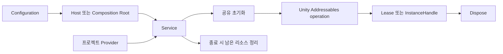

# Addressables: 수명과 설계

[English](Design.en.md) · [설치와 상세 API](../README.md)

## 해결하는 문제

Unity Addressables는 로드·참조 카운트·인스턴스 생성을 제공합니다. 이 패키지는 한 서비스가 소유한
리소스 추적, 초기 Catalog 정책, asset와 instance의 다른 해제 방법, 취소 뒤 정리를 일관되게 만듭니다.
Bundle 제작·배포 서버·원격 콘텐츠 빌드 파이프라인은 제공하지 않습니다.

| 타입 | 책임 | 보관할 값 |
| --- | --- | --- |
| `AddressablesConfiguration` | 직렬화 정책 | 실행 중 handle을 소유하지 않음 |
| `AddressablesHost` | Unity 객체 수명과 Service 연결 | Scene/Application 수명에 맞는 Host |
| `IAddressablesService` | 로드와 생성의 소비 계약 | 프로젝트 Provider가 의존할 인터페이스 |
| `AddressablesService` | 초기화와 미해제 리소스 추적 | 자체 생성 시 직접 Dispose |
| `AddressableAssetLease<T>` | 에셋 operation 하나의 해제 책임 | Asset을 사용하는 동안 Lease 유지 |
| `AddressableAssetCollectionLease<T>` | collection operation의 해제 책임 | 항목마다 개별 Release하지 않음 |
| `AddressableInstanceHandle` | 생성 인스턴스와 operation | Dispose가 ReleaseInstance 수행 |

## 획득부터 종료까지

1. Host의 Service 또는 직접 생성한 Service를 획득합니다.
2. key나 직렬화 AssetReference로 요청합니다. Load/Instantiate는 초기화를 자동 보장합니다.
3. 성공한 Lease/Handle을 보관하고 그 값으로 Renderer·UI·게임 시스템을 구성합니다.
4. 사용처의 참조를 제거하고 소유 Lease/Handle을 Dispose합니다.
5. Host/Service 종료 시 남아 있는 리소스를 정리하고, 설정에 따라 미해제 진단을 기록합니다.

Service 종료는 해당 Service가 추적하는 retained Lease도 해제합니다. `Retain`은 원본 Lease와
독립적인 해제 책임을 만들지만 Service보다 긴 수명을 보장하지 않습니다.

## 취소·실패·초기화

취소는 진행 중인 Unity operation을 즉시 중단하는 계약이 아닙니다. 구현은 operation 완료 뒤
토큰을 검사하고, 취소·실패 시 획득 handle을 정리하고 예외를 전달합니다.
따라서 `destroyCancellationToken`을 전달하더라도 실제 I/O가 즉시 멈춘다고 가정하면 안 됩니다.

초기화는 같은 Service 안에서 공유됩니다. 한 호출자의 취소가 공유 초기화 자체를 취소하지 않습니다.
초기화 실패 뒤에는 다시 시도할 수 있습니다. Catalog 갱신은 최초 사용 단계에서만 수행하며,
리소스를 보유한 상태에서 임의로 Catalog를 바꾸는 공개 API는 없습니다.
부분 실패 collection의 결과를 성공 Lease로 반환한다고 가정하지 마세요. operation 상태 실패는 예외입니다.

Configuration 기본값은 instance `HandleLifetime`, 초기 Catalog 갱신 꺼짐,
Catalog 갱신 후 미참조 cache 정리 켬, 종료 시 미해제 진단 켬, allocation stack capture 꺼짐입니다.
빈 key와 잘못된 Reference는 거부하고 Dispose한 Service는 재사용할 수 없습니다.

## 자동 해제와 저수준 해제 구분

기본 instance 정책은 Handle 수명입니다. 저수준 호출부가 Handle을 직접 소유하면 Dispose해야 합니다.
별도 Addressables Ownership 패키지의 `[ManagedAsset]`와 생성 setter를 쓰면 교체·owner 파괴가
해제를 자동 수행합니다. 두 방식을 하나의 리소스에 중복 적용하지 마세요.

레거시 `ReleaseOnDestroy`는 인스턴스 Observer의 파괴 이벤트로 남은 operation을 정리하며
Obsolete입니다. Sprite·Material처럼 같은 파괴 이벤트를 사용할 수 없는 일반 에셋의 자동 수명은
owner에 연결된 생성 경로가 담당합니다. `Explicit`은 `HandleLifetime`의 레거시 이름입니다.

## 실행과 코드 탐색

[Basic Usage](../Samples~/BasicUsage)의 Setup 메뉴로 소비 프로젝트의 Addressables 설정에
샘플 에셋을 등록한 뒤 Scene에서 Prefab 생성·해제와 TextAsset load·해제를 확인합니다.
[AddressablesSample](../Samples~/BasicUsage/AddressablesSample.cs)에서 실제 호출과 예외 처리를 볼 수 있습니다.

[Service](../Runtime/AddressablesService.cs) → [asset Lease](../Runtime/AddressableAssetLease.cs) →
[instance Handle](../Runtime/AddressableInstanceHandle.cs) 순으로 읽습니다.
[PlayMode 테스트](../Tests/Runtime)는 실제 로드, 취소, retain, 외부 Destroy 정책의 회귀 사례입니다.
패키지를 consumer manifest의 `testables`에 등록해 실행합니다. 이전 테스트 실행 기록과 새 실행 결과는
구분하고, 정상 설치 확인만으로 모든 비동기 경로의 통과를 주장하지 않습니다.
