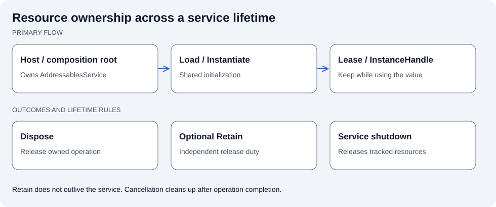

# Jeomseon Unity Addressables

[한국어](README.md) | English

Adds service lifetimes, resource tracking, asset Leases, and prefab InstanceHandle release contracts to Unity Addressables.



Keep the Lease/Handle for the entire usage period. Retain splits release responsibility but does not extend the Service lifetime.

## Quick start

Use a Host or directly constructed Service, Load/Instantiate, keep the Lease/Handle during use, then Dispose. Host shutdown cleans up the Service's remaining resources.

The Service is supplied by a configured Host or composition root. This method copies text before disposing its Lease.

```csharp
using System.Threading;
using Jeomseon.Unity.Addressables;
using UnityEngine;

public static class AddressablesExample
{
    public static async Awaitable<string> ReadMessageAsync(
        IAddressablesService service, string key, CancellationToken token)
    {
        using AddressableAssetLease<TextAsset> lease =
            await service.LoadAssetAsync<TextAsset>(key, token);
        return lease.Asset.text;
    }
}
```

## Contracts and limitations

Cancellation does not immediately stop I/O. Retain does not outlive its Service. Owner-bound automation is supplied by the separate Addressables Ownership package.

## Requirements

- Unity `6000.6.0f1`
- Package: `com.jeomseon.unity.addressables` `0.4.0`
- `com.unity.addressables`: `2.9.1`

## Installation

Merge this into your project's `Packages/manifest.json`; preserve existing dependencies and registries.

```json
{
  "scopedRegistries": [
    {
      "name": "OpenUPM",
      "url": "https://package.openupm.com",
      "scopes": [
        "com.jeomseon"
      ]
    }
  ],
  "dependencies": {
    "com.jeomseon.unity.addressables": "0.4.0"
  }
}
```

Or use **Install package from git URL** in Package Manager:

```text
https://github.com/jeomseon0516/Unity.Addressables.git#v0.4.0
```

## Design and behavior

### Scope

Unity Addressables supplies loading, reference counts, and instantiation. This package coordinates
scope-owned resource tracking, initial Catalog policy, distinct asset/instance release paths, and
cleanup after cancellation. It does not provide content servers or Bundle build/deployment pipelines.

| Type | Responsibility | Consumer contract |
| --- | --- | --- |
| `AddressablesConfiguration` | Serialized policy | Owns no runtime handles |
| `AddressablesHost` | Connects Unity lifetime to a Service | Choose Scene or persistent Application lifetime |
| `IAddressablesService` | Loading/instantiation interface | Suitable dependency for a project Provider |
| `AddressablesService` | Initialization and resource tracking | Dispose it when constructed directly |
| `AddressableAssetLease<T>` | One asset operation's release responsibility | Keep the Lease while using its Asset |
| `AddressableAssetCollectionLease<T>` | One collection operation | Do not release individual items separately |
| `AddressableInstanceHandle` | Instance and operation | Dispose calls ReleaseInstance |

### Lifecycle

Obtain the Host Service or construct one, request by key or AssetReference, retain the returned
Lease/Handle while using its value, detach consumers, then Dispose. Load/Instantiate ensure initialization.
Host/Service shutdown releases remaining resources and can log outstanding allocations.

Retain creates an independent release responsibility but remains tracked by the same Service.
It does not extend a resource beyond that Service's lifetime.

### Cancellation, failure, and defaults

Cancellation does not promise to immediately abort Unity's operation. The implementation awaits the
operation, checks the token, releases the acquired handle on cancellation/failure, and propagates the
exception. Passing destroyCancellationToken does not mean I/O stops immediately.

Initialization is shared within a Service. One caller's cancellation does not cancel shared initialization.
Initialization failures permit retry. Catalog updates occur before first use; there is no public API for
arbitrary updates while resources are owned. Failed collection operations throw rather than returning
a successful partial-result Lease.

Defaults: HandleLifetime for instances, Catalog updates off, unused cache cleanup after updates on,
outstanding-resource diagnostics on, allocation stack capture off. Empty keys and invalid References
are rejected. A disposed Service cannot be reused.

### Automatic and low-level release

Low-level callers own and Dispose the returned Handle. The separate Addressables Ownership package
automates replacement and owner-destruction release with ManagedAsset and generated setters. Avoid
assigning competing lifetime responsibilities for the same resource.

Legacy ReleaseOnDestroy uses an instance Observer and is Obsolete. Ordinary assets such as Sprite and
Material lack that instance destruction event; owner-bound generation provides their automatic lifetime.
Explicit is the legacy name of HandleLifetime.

### Run and inspect

Import [Basic Usage](Samples~/BasicUsage), run its Setup menu to register sample content in the
consumer project's Addressables settings, and exercise Prefab/TextAsset acquisition and release.
[AddressablesSample](Samples~/BasicUsage/AddressablesSample.cs) shows calls and exception handling.
Read [Service](Runtime/AddressablesService.cs), [asset Lease](Runtime/AddressableAssetLease.cs),
then [instance Handle](Runtime/AddressableInstanceHandle.cs).
[PlayMode tests](Tests/Runtime) cover real loading, cancellation, retain, and external Destroy policies.
Add the package to manifest testables. Distinguish historical results from a new test run; successful
installation alone does not verify every asynchronous path.

## API usage and details

### Setup

1. Create an `AddressablesConfiguration` from `Tool/Addressables/Configuration`.
2. Add `AddressablesHost` to a root GameObject.
3. Assign the configuration to the host.
4. Pass `host.Service` as `IAddressablesService` to a composition root or provider.

Configuration assets contain policy only and never own runtime handles. A host lazily creates
its service and disposes every remaining lease and instance when the host is destroyed. Enable
`Dont Destroy On Load` for an application-lifetime host; a persistent host must be on a root
GameObject.

Configuration options control:

- explicit or external-destroy-safe prefab release;
- catalog update during first initialization;
- unused bundle-cache cleanup after a catalog update;
- warnings for resources still outstanding when the service is disposed;
- optional allocation stack traces for leak diagnostics.

### Dynamic keys and serialized references

Use dynamic keys for server-provided or runtime-selected content:

```csharp
AddressableAssetLease<Material> lease =
    await service.LoadAssetAsync<Material>(runtimeKey, cancellationToken);
```

Use a type-safe serialized reference for project-owned assets:

```csharp
[SerializeField] private AssetReferenceTexture2D _texture;

AddressableAssetLease<Texture2D> lease =
    await service.LoadAssetReferenceAsync<Texture2D>(
        _texture,
        cancellationToken);
```

When Unity does not provide a concrete reference for a type, define a small derived reference:

```csharp
[Serializable]
public sealed class MaterialReference : AssetReferenceT<Material>
{
    public MaterialReference(string guid) : base(guid) { }
}
```

An asmdef that uses the serialized-reference API must directly reference `Unity.Addressables`.
Consumers that only use dynamic-key methods do not need that extra assembly reference.

### Asset ownership

Keep a lease alive for as long as another object uses its asset:

```csharp
private AddressableAssetLease<Material> _materialLease;

private async Awaitable LoadAsync(CancellationToken cancellationToken)
{
    renderer.sharedMaterial = null;
    _materialLease?.Dispose();
    _materialLease = await service.LoadAssetReferenceAsync<Material>(
        _material,
        cancellationToken);
    renderer.sharedMaterial = _materialLease.Asset;
}
```

Clear consumers and dispose the lease when ownership ends. A local `using` is appropriate only when all use of
the asset finishes inside that scope. Call `lease.Retain()` to create an independently owned lease for a
longer-lived owner. With `[ManagedAsset]`, use the generated `Retain{Name}()` method.
Collection leases support the same `Retain()` contract and can be automated with `[ManagedAssetCollection]`.

`Dispose` is idempotent. After disposal, `IsValid` is false and that Lease no longer keeps the asset alive.
Clear references from Renderers/UI before releasing their Lease. Serialize replacement requests at the
calling boundary; the snippets assume one request at a time and show method bodies inside a component.

Load a serialized label into one collection lease:

```csharp
AddressableAssetCollectionLease<Sprite> icons =
    await service.LoadLabelAssetsAsync<Sprite>(
        _uiIcons,
        releaseDependenciesOnFailure: true,
        cancellationToken: cancellationToken);
```

Dispose the collection lease once; do not release each item separately.

### Prefab instances

```csharp
AddressableInstanceHandle handle =
    await service.InstantiateReferenceAsync(
        _enemyPrefab,
        parent,
        cancellationToken);

Enemy enemy = handle.GetComponent<Enemy>();
```

Call `handle.Dispose()` for normal removal. It uses `Addressables.ReleaseInstance` to destroy the
GameObject and release its operation together.

The default `HandleLifetime` policy places lifetime responsibility on the returned handle. Low-level callers
dispose it directly. When the handle is assigned through a generated setter on a `[ManagedAsset]` field from
`com.jeomseon.unity.addressables.ownership`, replacement and owner destruction release it automatically and
user code does not call `Dispose()`.

Legacy `ReleaseOnDestroy` attaches an observer component so external `Destroy` releases the operation. Its
serialized value remains supported, but new source references receive an `[Obsolete]` warning. `Explicit` is
also retained as an obsolete alias for `HandleLifetime`.

### Initialization, catalogs, and cancellation

Every load and instantiate operation ensures initialization. You can initialize earlier:

```csharp
await service.InitializeAsync(cancellationToken);
```

Concurrent initialization calls share one task. If configured, the first initialization checks
for catalog updates, applies discovered catalogs, and optionally removes unused cached bundles
before resources are loaded.

A cancellation token does not forcibly abort Unity's underlying Addressables download. Once the
operation completes, the service observes cancellation, releases the resulting handle, and throws
`OperationCanceledException`, so canceled results never remain owned by the service.

Invalid keys, invalid references, failed operations, and use of a disposed Service are reported as
exceptions. Handle cancellation separately from load failures in `async void` Unity entry points.

### Direct service ownership

Create `new AddressablesService(configuration)` when an Inspector Host is unnecessary. The composition
root that creates it must keep and Dispose it. `Initialize On Start` on a Host prewarms initialization;
loads still ensure initialization automatically when this option is disabled.

Disposing the Service releases its tracked asset Leases, collection Leases, retained Leases, and instance
Handles. A disposed Service cannot be reused. Never keep only an `Asset` reference after releasing its
Lease, release collection items individually, or use both manual release and generated ownership for the
same operation.

### Diagnostics

```csharp
Debug.Log(service.ActiveResourceCount);

foreach (AddressableResourceInfo info in service.ActiveResources)
{
    Debug.Log($"{info.Kind}: {info.Key}, {info.ResourceType.Name}");
}
```

Each diagnostic entry contains its resource kind, key, type, UTC creation time, and an optional
allocation stack trace. In Play Mode, the `AddressablesHost` Inspector displays initialization,
active ownership, age, and stack traces without creating a service merely for inspection.

Allocation stack capture has a cost and should normally be enabled only while diagnosing a leak.
The service can also warn when it must dispose resources that their immediate owners did not
release first.

### Recommended provider boundary

Production gameplay should usually depend on a domain provider rather than keys, leases, or
Addressables types. The provider receives `IAddressablesService` and a serialized asset
configuration, owns leases and instance handles, and returns domain objects.

The `Basic Usage` sample demonstrates:

[`AddressablesSampleAssets`](Samples~/BasicUsage/AddressablesSampleAssets.cs) stores the typed
references. [`AddressablesSampleContentProvider`](Samples~/BasicUsage/AddressablesSampleContentProvider.cs)
keeps the Leases/Handles, reuses the TextAsset Lease, and exposes domain operations to the sample caller.

- a ScriptableObject containing typed prefab and TextAsset references;
- a provider that owns multiple prefab handles and a shared TextAsset lease;
- individual release, release-all, and external-destroy cleanup;
- active resource diagnostics in the host Inspector.

### API guide

| Input and target | API | Owned result |
| --- | --- | --- |
| Dynamic key, one asset | `LoadAssetAsync<T>` | `AddressableAssetLease<T>` |
| Serialized reference, one asset | `LoadAssetReferenceAsync<T>` | `AddressableAssetLease<T>` |
| Dynamic key or label, many assets | `LoadAssetsAsync<T>` | `AddressableAssetCollectionLease<T>` |
| Serialized label, many assets | `LoadLabelAssetsAsync<T>` | `AddressableAssetCollectionLease<T>` |
| Dynamic prefab key | `InstantiateAsync` | `AddressableInstanceHandle` |
| Serialized prefab reference | `InstantiateReferenceAsync` | `AddressableInstanceHandle` |

### Future considerations

The public interface records future consideration for owned scene leases, dependency download and
size operations, explicit runtime catalog updates, progress and timeout policy, and location
queries. These are intentionally deferred until concrete project requirements justify expanding
the ownership model.

### Basic Usage sample

Import `Basic Usage` from Package Manager, run
`Jeomseon/Addressables/Setup Basic Usage Sample`, and open
`Scenes/AddressablesBasicUsage`. The scene verifies serialized references, multiple provider-owned
instances, explicit release, a TextAsset lease, and live diagnostics. The included configuration retains
legacy `ReleaseOnDestroy` (serialized value 1) to demonstrate external-destroy cleanup. Newly created
configurations default to `HandleLifetime`; use Addressables Ownership for new owner-bound automation.

## Verify the behavior

1. Import Basic Usage, run the Setup menu described in its README, and open the Scene.
2. In Play Mode, exercise Prefab instantiate/release and TextAsset load/release separately. Check both success logs and visible state.
3. For retained Leases, distinguish continued use after releasing the original from invalidation at Service shutdown.
4. For automatic owner-bound release, use the ManagedAsset sample in Addressables Ownership. Do not separately Release the same operation.

## Samples

Import the desired entry from **Package Manager > Samples**. Use the included Scene/Editor tool and complete its Setup step first, if required.

- [Basic Usage](Samples~/BasicUsage/README.md)
  - [AddressablesBasicUsage](Samples~/BasicUsage/Scenes/AddressablesBasicUsage.unity)

## Tests

[Test sources](Tests)

Add the package ID to manifest `testables`, then execute its relevant EditMode/PlayMode assemblies in Unity Test Runner.

## Further reading

[Complete source map and package metadata](Documentation~/Overview.en.md)
- [Changelog](CHANGELOG.md)

## License

[License](LICENSE.md)
